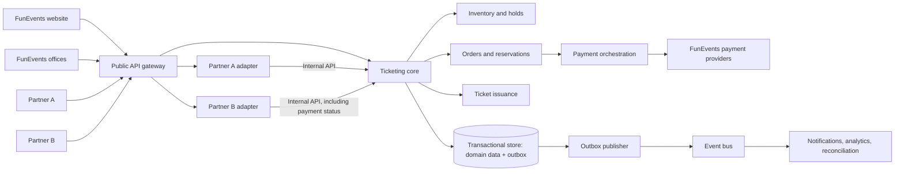
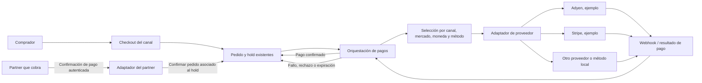
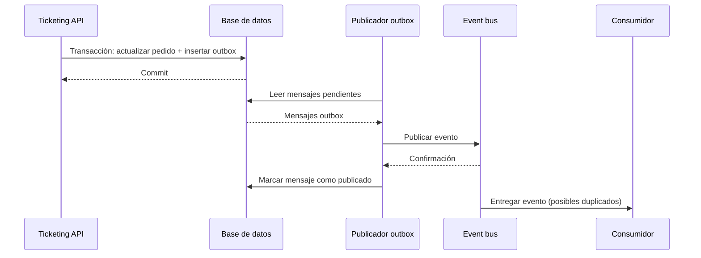
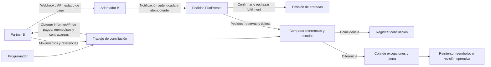
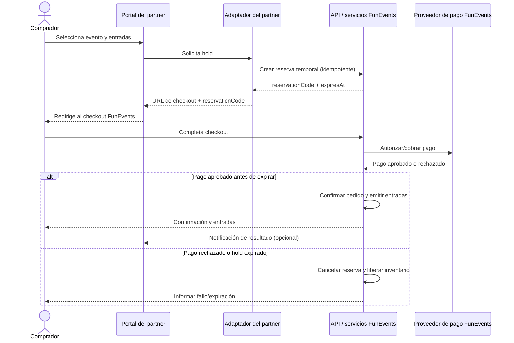
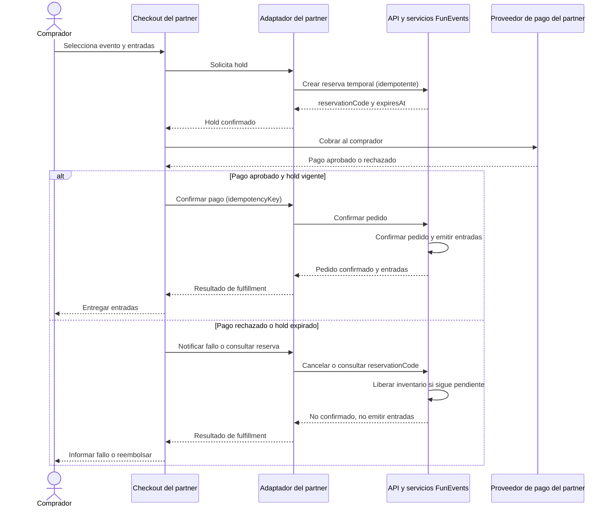
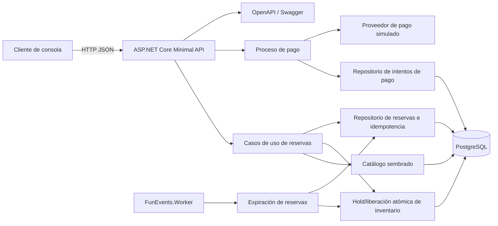
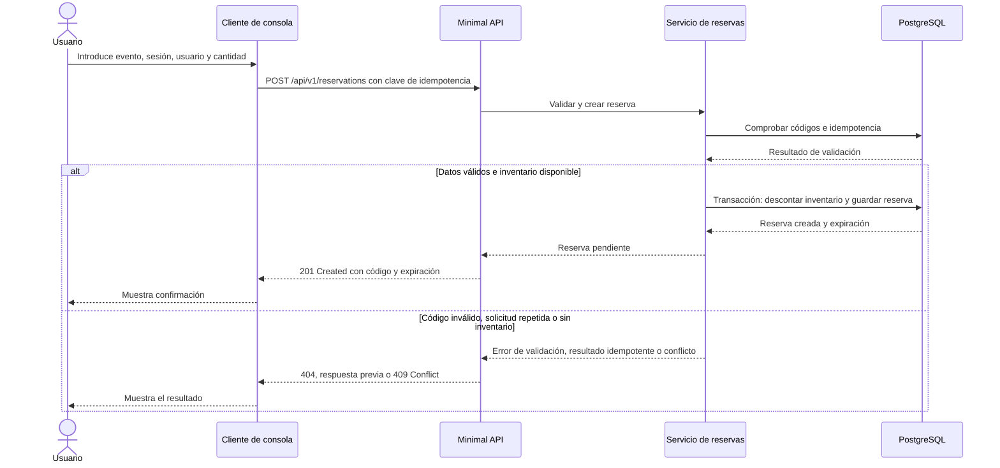
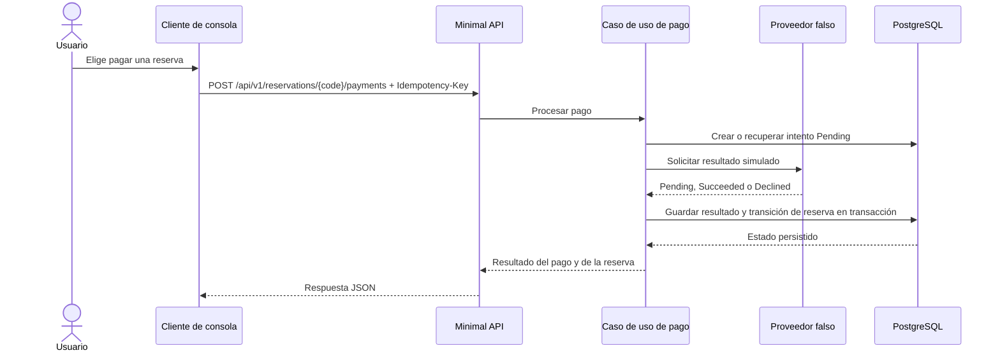

# FunEvents — Diseño inicial

## 1. Objetivo y alcance

Diseñar una plataforma de venta de entradas para FunEvents que atienda el portal propio, las oficinas de atención al cliente y los canales de colaboradores. La plataforma debe permitir que cada canal integre la compra en su propia experiencia sin perder el control central de catálogo, disponibilidad y emisión de entradas.

Este documento define la arquitectura objetivo y describe el prototipo técnico de la Parte 2: un cliente de consola que consume una API web para gestionar reservas, pagos simulados y expiración de holds.

## 2. Requisitos y supuestos

### Requisitos funcionales

- Consultar eventos y sus sesiones/funciones.
- Consultar disponibilidad y reservar entradas desde distintos canales.
- Identificar el canal que origina cada operación.
- Permitir integraciones de colaboradores mediante APIs documentadas y credenciales propias.
- Evitar sobreventa cuando varios canales intentan reservar las últimas entradas a la vez.
- En el sistema completo: confirmar pagos, emitir entradas y gestionar cancelaciones y devoluciones.

### Supuestos para el prototipo

- El evento y el usuario ya existen y se identifican por código.
- La petición de reserva indica una sesión y una cantidad de entradas; el código de evento por sí solo no determina qué función se desea.
- El prototipo no realiza cobros reales. La reserva queda temporalmente pendiente de confirmación y vence tras un plazo configurable; el proveedor simulado devuelve resultados de pago.
- Habrá una base de datos relacional para persistir inventario y reservas. PostgreSQL es la opción propuesta.
- Un canal colaborador se identifica por una credencial/API key en el prototipo. En producción se recomienda OAuth 2.0 Client Credentials, con permisos por colaborador y rotación de secretos.

## 3. Arquitectura propuesta

### 3.1 Propuesta: adaptador desplegable por partner



La API canónica ofrece operaciones comunes de FunEvents. Cada partner tiene un adaptador como límite de integración y despliegue: valida la autenticación externa, aplica el contrato y modelo de datos del partner, y dirige su flujo de compra hacia las operaciones canónicas. Los adaptadores invocan FunEvents con identidades de servicio propias y permisos limitados; no transmiten credenciales externas al núcleo.

Los módulos de dominio centrales conservan las invariantes que deben ser iguales para todos los canales, especialmente disponibilidad, reservas idempotentes, estado de pedidos y emisión. Los adaptadores pueden escalar y evolucionar de forma independiente. Para un volumen bajo o para el prototipo, un adaptador podría ejecutarse inicialmente como módulo del mismo proceso; la frontera lógica debe permitir separarlo sin trasladar reglas de inventario o pedidos.

#### Motivos de selección

- **Capacidad de escalado independiente:** si un partner concentra picos de tráfico (por ejemplo, una preventa), se pueden añadir instancias y recursos a su adaptador sin escalar todos los conectores. Esto no elimina la necesidad de escalar y proteger el núcleo compartido de inventario, que sigue siendo un posible cuello de botella.
- **Límite claro de autenticación e integración:** cada partner puede usar su mecanismo de autenticación y su contrato, mientras FunEvents mantiene una identidad interna uniforme entre adaptadores y API canónica.
- **Evolución y despliegues independientes:** cambios en el esquema, autenticación o flujo de un partner pueden probarse y publicarse sin exigir una versión coordinada para los demás.
- **Aislamiento de recursos y fallos:** saturación, errores o dependencias externas defectuosas de un adaptador tienen un alcance menor. Deben existir límites de concurrencia, timeouts y circuit breakers para evitar que el problema alcance los servicios comunes.
- **Diferencias reales de flujo:** se esperan cambios de pasos, orden, handoffs de checkout y responsabilidades de pago, no solo traducción de campos o configuración visual. Cada adaptador puede implementar la orquestación externa correspondiente y llamar a las mismas operaciones centrales.

#### Tradeoffs y límites

- **Más coste operativo:** cada adaptador independiente añade despliegue, configuración, monitorización, alertas, parches de seguridad y soporte. Conviene reservar despliegues separados para partners cuyo volumen, aislamiento o ritmo de cambio lo justifique.
- **El núcleo sigue siendo compartido:** todos los canales compiten por inventario. La consistencia y prevención de sobreventa se resuelven en los servicios centrales y la base de datos, no duplicando lógica en adaptadores.
- **Riesgo de divergencia:** las reglas de reserva, precios y emisión no deben copiarse a cada adaptador; deben vivir en el núcleo canónico. Los adaptadores orquestan, autentican y traducen.
- **Superficie de integración mayor:** cada contrato debe versionarse, documentarse y observarse. Se requieren trazas correlacionadas desde el partner hasta la reserva.

### 3.2 Componentes y responsabilidades

Estos son límites lógicos; no implican que cada caja sea un despliegue independiente. El núcleo puede empezar como una aplicación modular. Los adaptadores de partners con requisitos de carga, aislamiento o ciclo de cambios propios sí pueden desplegarse por separado.

| Componente                | Propósito y responsabilidades                                                                                                                                                                      |
| ------------------------- | -------------------------------------------------------------------------------------------------------------------------------------------------------------------------------------------------- |
| API gateway               | Entrada pública; termina TLS, enruta peticiones a APIs/adaptadores y aplica políticas comunes como límites de tráfico y trazabilidad. No contiene reglas de reservas ni pagos.                     |
| Adaptador por partner     | Valida el esquema de autenticación propio del partner, traduce su contrato/datos y coordina su flujo de checkout. Llama al núcleo con identidad de servicio FunEvents.                             |
| Ticketing core            | API y casos de uso canónicos para canales propios y partners; aplica reglas comunes y delega en módulos de dominio.                                                                                |
| Catálogo                  | Eventos, recintos, sesiones, zonas y precios.                                                                                                                                                      |
| Inventario y reservas     | Disponibilidad, holds con expiración y prevención de sobreventa.                                                                                                                                   |
| Pedidos                   | Estado de la compra y vínculo entre reserva, comprador, canal, pago y entradas.                                                                                                                    |
| Orquestación de pagos     | Inicia y consulta pagos cuando FunEvents cobra; normaliza estados de proveedores y coordina su efecto en el pedido. No procesa el dinero por sí sola.                                              |
| Emisión de entradas       | Genera y mantiene entradas/QR tras confirmarse el pedido; soporta entrega y validación en acceso.                                                                                                  |
| Almacén transaccional     | Persiste el estado actual de dominio. En la primera versión puede ser una base relacional; los módulos acceden mediante interfaces y límites definidos, no escribiendo libremente cualquier tabla. |
| Outbox y publicador       | Registra eventos de integración en la misma transacción que el cambio de dominio y los publica de forma asíncrona.                                                                                 |
| Procesos en segundo plano | Expiran holds, publican outbox, envían notificaciones y ejecutan conciliaciones; deben ser idempotentes y observables.                                                                             |

### 3.3 Flujos y patrones detallados

#### Orquestación de pagos y proveedores

Un **método de pago** es la forma elegida por el comprador (por ejemplo, tarjeta, cartera digital o método local). Un **proveedor** procesa ese método. La orquestación decide qué integración usar según el mercado, moneda, canal y métodos habilitados. Los nombres mostrados son ejemplos de proveedores posibles, no una selección de FunEvents; disponibilidad, cobertura y condiciones deben validarse por mercado antes de elegir. Como referencias iniciales, consultar los catálogos de métodos de [Adyen](https://docs.adyen.com/payment-methods/) y [Stripe](https://docs.stripe.com/payments/mobile/embedded).



Cuando FunEvents cobra, el proveedor informa el resultado a FunEvents y la orquestación actualiza el pedido de forma idempotente. En el modelo del partner, el partner cobra y notifica el resultado; FunEvents no debe marcar como pagado basándose en una redirección del navegador, sino en una notificación autenticada o consulta servidor a servidor.

#### Outbox transaccional

El outbox evita perder un evento entre la escritura de datos y su publicación. El registro del pedido/reserva y el mensaje outbox se confirman juntos; un publicador reintenta enviar los mensajes pendientes. Los consumidores deben tolerar duplicados.



#### Conciliación de pagos de partners

En el flujo «Caso B: el partner cobra al comprador» de la sección 4, el aviso de pago del partner permite confirmar la compra en tiempo real. Una conciliación periódica sirve como control de discrepancias y recuperación; no reemplaza el aviso de pago. Se comparan los pagos y reembolsos reportados por el partner con pedidos, holds y entradas de FunEvents. Las excepciones se reintentan o pasan a revisión operativa; nunca se emiten entradas solo porque una fila de conciliación no tenga discrepancias.



La conciliación requiere referencias compartidas e idempotentes, como `partnerOrderId`, `reservationCode` y `paymentReference`, además de acuerdos sobre plazos, moneda, comisiones, reembolsos y contracargos.

### 3.4 Preocupaciones de diseño transversales

#### Dominio y persistencia

Catálogo, inventario, reservas/pedidos, pagos y entradas son capacidades de dominio; su separación lógica no obliga a separar procesos o bases desde el primer día. Los casos de uso coordinan operaciones. Las escrituras de inventario y reserva/pedido que requieren atomicidad se mantienen en una transacción de la base relacional inicial. Si se extraen servicios en el futuro, cada servicio será dueño de sus datos y otros servicios usarán APIs/eventos, no tablas ajenas.

El proveedor de pago es un sistema externo conectado mediante una interfaz y adaptadores. No forma parte del almacén de dominio ni de la transacción local de inventario.

#### Concurrencia y consistencia de inventario

El objetivo es que dos solicitudes simultáneas no puedan reservar las mismas últimas entradas. La base de datos debe decidir de forma atómica cuál solicitud obtiene el inventario; una comprobación previa en la aplicación no basta.

Para reservar `requestedQuantity`, se propone una actualización condicional dentro de una transacción:

```sql
UPDATE inventory
SET available = available - @requestedQuantity
WHERE session_code = @sessionCode
  AND available >= @requestedQuantity;
```

Si se actualiza una fila, la transacción crea la reserva pendiente y registra su clave de idempotencia. Si no se actualiza ninguna fila, no hay inventario suficiente y la API responde, por ejemplo, `409 Conflict`. Si falla la creación de la reserva, la transacción revierte también el descuento. Un proceso expira holds y devuelve inventario una sola vez.

La concurrencia optimista usa una versión de fila para detectar cambios concurrentes; resulta útil cuando los conflictos son poco frecuentes y se quiere evitar sobrescribir datos. Para descontar inventario, la actualización condicional suele ser más sencilla. Si las métricas muestran contención alta, se evaluarán bloqueos o serialización para el inventario afectado.

Una sala de espera virtual regula cuántos compradores entran al checkout; resulta útil ante picos previsibles o saturación observada. No reserva entradas: cada comprador admitido aún debe obtener un hold y puede encontrar el evento agotado. Las colas internas se reservan para trabajo asíncrono, como notificaciones y conciliación. No se retiene inventario para quienes esperan ni se mantienen transacciones abiertas durante llamadas externas.

#### Event sourcing

Event sourcing no es un requisito inicial. Guarda eventos de dominio como fuente de verdad y reconstruye el estado reproduciéndolos; no es lo mismo que publicar eventos de integración mediante outbox. Añade complejidad en versionado, proyecciones, consistencia eventual, consultas y operación.

Se recomienda empezar con estado relacional convencional, auditoría y outbox transaccional. Reconsiderar event sourcing solo si hay requisitos concretos de reconstrucción histórica completa, auditoría inmutable de alto detalle o múltiples proyecciones independientes; no se adopta para resolver concurrencia.

#### Límites de confianza y acceso

- El portal y las oficinas usan identidad de usuario; las oficinas registran también el agente que atendió la operación.
- Cada adaptador valida la autenticación específica del partner. Sus credenciales se gestionan y rotan de forma independiente y no identifican al comprador final.
- El adaptador se autentica ante la API interna con identidad de servicio FunEvents y permisos limitados al partner y operaciones permitidas.
- Cada operación registra `channelId`, origen y actor para auditoría, soporte y liquidación.
- El gateway aplica controles comunes de entrada; el adaptador aplica autenticación/validación específica del partner y el núcleo autoriza operaciones. Usar TLS, límites de tráfico, gestión de secretos y trazas sin datos sensibles.

## 4. Flujos principales

### Reserva (prototipo)

1. El cliente envía código de evento, código de usuario, sesión, cantidad, canal e identificador de idempotencia.
2. La API valida que evento, sesión y usuario existen y que el canal está autorizado.
3. En una transacción, el servicio comprueba y descuenta/bloquea disponibilidad de forma atómica.
4. Se crea una reserva `Pending` con fecha de expiración y se devuelve su código.
5. Las solicitudes repetidas con la misma clave de idempotencia devuelven el mismo resultado, sin crear otra reserva.
6. Un proceso de expiración libera inventario de reservas vencidas.

### Compra real y emisión de entradas (fuera del prototipo)

La Parte 2 incluye un proveedor de pago falso para probar el flujo de estados, pero no procesa dinero real ni emite entradas. En producción, tras el resultado del proveedor real, el sistema confirmará el pedido y emitirá entradas; si el pago falla o expira la reserva, liberará inventario. Las llamadas al proveedor y las notificaciones no deben ejecutarse dentro de la transacción de inventario. Se recomienda patrón outbox para publicar eventos de forma fiable.

### Casos de uso de checkout con partners

Los siguientes casos muestran dos modelos de responsabilidad de pago. En ambos, FunEvents conserva la autoridad sobre el inventario, la reserva y la emisión de entradas. El partner se autentica en su adaptador; este llama a la API canónica con identidad de servicio FunEvents.

#### Caso A: FunEvents cobra al comprador

El partner solicita un hold temporal y redirige al comprador al checkout de FunEvents. FunEvents procesa el pago. Si el pago se confirma antes de vencer el hold, confirma el pedido y emite las entradas. Si falla o vence, cancela la reserva y devuelve inventario.



#### Caso B: el partner cobra al comprador

El partner solicita primero un hold para reducir el riesgo de cobrar por entradas no disponibles. El partner procesa el pago en su propio checkout y comunica el resultado. FunEvents confirma el pedido y emite entradas solo cuando recibe una confirmación válida antes de que venza el hold. El partner liquida después con FunEvents según el acuerdo comercial; esa liquidación entre empresas es externa al flujo técnico de compra.



Este segundo modelo tiene un riesgo de coordinación: el pago del partner puede aprobarse y el hold expirar antes de que FunEvents reciba la confirmación. El contrato de integración debe definir tiempos límite, reintentos idempotentes, consulta del estado del pedido y el proceso de reembolso/compensación. La reserva no debe confirmarse solo porque el partner indique un cobro si el hold ya venció.

### Decisiones pendientes para la plataforma completa

Estas decisiones afectan a la arquitectura de producción, pero quedan fuera del alcance del prototipo de reserva:

1. ¿Qué medios y proveedores de pago ofrecerá FunEvents por mercado, y quién será el comerciante responsable en cada canal?
2. Para los partners que cobran directamente, ¿cómo se reportarán pagos, reembolsos y contracargos, y qué mecanismo de liquidación/reconciliación se requiere?
3. ¿Qué nivel de contención de inventario se espera durante los picos de venta y qué objetivos de latencia/disponibilidad se deben cumplir?
4. ¿Hay requisitos de auditoría o reconstrucción histórica que justifiquen event sourcing, más allá del historial de pedidos y una auditoría convencional?

## 5. Parte 2: Prototipo técnico

### Objetivo y alcance

El prototipo demuestra un recorrido vertical: un cliente de consola usa una API ASP.NET Core para crear, consultar y cancelar reservas de eventos, sesiones y usuarios conocidos. Incluye un endpoint de pago simulado y un worker que expira reservas pendientes. La API reserva inventario de forma atómica y persiste las reservas y los intentos de pago. El propósito es validar el contrato API, la persistencia, la consistencia de inventario y los límites entre API, casos de uso, proveedor simulado y proceso de fondo. No implementa cobros reales, emisión de entradas ni conciliación de pagos de partners.

El cliente no accede directamente a la base de datos. La reserva queda pendiente hasta cancelarse, confirmarse mediante el flujo de pago simulado o expirar. PostgreSQL conserva el estado entre llamadas. Los datos de evento, sesión, usuario e inventario se cargan mediante la semilla de desarrollo; el prototipo no expone endpoints para consultar o administrar el catálogo.

#### Arquitectura del prototipo



El cliente solo conoce la API HTTP. Los casos de uso coordinan las reglas y los repositorios ocultan el acceso a PostgreSQL. El hold de inventario, la reserva y su clave de idempotencia se confirman en una sola transacción. El worker es un proceso separado que ejecuta periódicamente el caso de uso de expiración; no depende de que el cliente consulte la reserva.

#### Flujo de reserva



### 5.1 API implementada

Base: `/api/v1`. Los endpoints implementados son:

| Método y ruta | Uso | Comportamiento |
| --- | --- | --- |
| `POST /reservations` | Crear una reserva temporal | `201 Created`; requiere `Idempotency-Key`. Repetir la misma solicitud devuelve el resultado previo. |
| `GET /reservations/{reservationCode}` | Consultar una reserva del canal autenticado | Devuelve estado, evento, sesión, cantidad y expiración; también comprueba si debe expirar. |
| `POST /reservations/{reservationCode}/cancel` | Cancelar una reserva pendiente | Actualiza el estado y libera el inventario una sola vez. |
| `POST /reservations/{reservationCode}/payments` | Ejecutar o reintentar un pago simulado | Requiere `Idempotency-Key`; devuelve los estados del pago y de la reserva. |

Todos estos endpoints requieren `X-Api-Key`. El canal se obtiene de la API key, no del cuerpo de la petición.

Petición para crear una reserva:

```http
POST /api/v1/reservations
X-Api-Key: local-console-secret
Idempotency-Key: c6d1c491-4bca-476c-b450-f676ce01b61f
Content-Type: application/json
```

```json
{
  "eventCode": "EVT-001",
  "sessionCode": "SES-001-A",
  "userCode": "USR-042",
  "quantity": 2
}
```

#### Pago simulado

El endpoint de pago crea un intento `Pending` persistido antes de invocar al proveedor falso. El proveedor devuelve aleatoriamente `Pending`, `Succeeded` o `Declined`; no se transfiere dinero real. Un resultado exitoso confirma la reserva solo si sigue pendiente y no ha vencido. Si ya no puede confirmarse, el intento queda `RefundRequired`, que representa una compensación pendiente: el prototipo no ejecuta reembolsos. Los intentos y el estado de la reserva se guardan en PostgreSQL. La respuesta incluye el código y estado del pago, y el estado de la reserva.



La clave de idempotencia identifica el intento de pago dentro del canal. Si el resultado permanece `Pending`, repetir la solicitud con la misma clave continúa ese intento en vez de crear otro.

#### Worker de expiración

`FunEvents.Worker` es un proceso .NET independiente del API. Cada 15 segundos busca hasta 100 reservas pendientes vencidas e intenta expirar cada una. En una transacción cambia el estado a `Expired` y devuelve la cantidad al inventario. El estado de la reserva actúa como token de concurrencia: si una cancelación, pago u otro worker gana la transición, el intento de expiración no libera inventario por segunda vez. Los errores de una pasada se registran y el worker vuelve a intentarlo en el siguiente ciclo.

El worker también puede ejecutarse sin Aspire. En ese modo hay que iniciarlo como proceso separado junto al API y PostgreSQL; sin el worker, las reservas vencidas se actualizan al consultarlas o al intentar pagarlas, pero no se procesan periódicamente en segundo plano.

Errores con `ProblemDetails`: `400` entrada inválida, `401/403` autenticación/autorización, `404` reserva/evento/sesión/usuario inexistente y `409` inventario insuficiente, conflicto de idempotencia o reserva no pagable. El API publica OpenAPI y Scalar en desarrollo; las rutas incluyen el prefijo `/api/v1`.

### 5.2 Modelo de datos mínimo

- `events(event_code, name, is_active)`
- `event_sessions(event_code, session_code, starts_at_utc, is_sales_open)`
- `session_inventory(event_code, session_code, available_quantity)`
- `users(user_code, display_name)`
- `reservations(id, reservation_code, event_code, session_code, user_code, channel_id, quantity, status, created_at_utc, expires_at_utc)`
- `reservation_idempotency(channel_id, idempotency_key, request_fingerprint, reservation_code, created_at_utc)`
- `payment_attempts(id, payment_code, reservation_code, channel_id, idempotency_key, status, provider_reference, created_at_utc, updated_at_utc)`

Restricciones e invariantes:

- `quantity > 0` y `available >= 0`.
- La actualización de disponibilidad y la inserción de reserva ocurren en una única transacción.
- Usar actualización condicional/`SELECT ... FOR UPDATE` o mecanismo equivalente para impedir carreras.
- Índice único para idempotencia dentro del ámbito definido (por canal/cliente autenticado).
- Los estados mínimos de reserva son `Pending`, `Confirmed`, `Cancelled` y `Expired`.
- El intento de pago guarda su código, reserva, canal, clave idempotente, referencia del proveedor y marcas de tiempo; sus estados son `Pending`, `Succeeded`, `Declined` y `RefundRequired`.

### 5.3 Cliente de consola

Aplicación de consola .NET 10 con menú interactivo para crear, consultar, cancelar o pagar una reserva. Al crear solicita `eventCode`, `sessionCode`, `userCode` y cantidad; propone los códigos de la semilla como valores por defecto. Llama a la API con `HttpClient`, muestra la respuesta y presenta errores HTTP de forma legible. El canal se determina por la API key. La URL base y la clave se leen de User Secrets o variables de entorno, con valores locales de desarrollo como fallback.

El cliente genera o acepta una clave de idempotencia para que un reintento de red no duplique la reserva. No accede directamente a PostgreSQL.

### 5.4 Tecnología y despliegue

- .NET 10 en la implementación actual, ASP.NET Core Minimal APIs.
- PostgreSQL para persistencia transaccional.
- EF Core con Npgsql; la reserva condicional de inventario se realiza en la base de datos dentro de una transacción.
- .NET Aspire AppHost orquesta PostgreSQL, API y worker; el cliente de consola está disponible como recurso de inicio explícito.
- Health check del API en `/health`; Aspire permite inspeccionar el estado y los logs de los recursos locales.
- Las migraciones crean el esquema y una semilla de desarrollo reproducible carga eventos, sesiones, usuarios e inventario.

### 5.5 Decisiones aplicadas al prototipo

- Cada reserva corresponde a una sesión; el máximo de entradas por reserva y la duración del hold son configurables (valores locales iniciales: 6 entradas y 10 minutos).
- La API usa API keys de desarrollo por canal; el canal se deriva de la credencial autenticada.
- La semilla de desarrollo proporciona los códigos conocidos de eventos, sesiones, usuarios e inventario.
- El pago se simula con resultados aleatorios; no hay cobro, devolución efectiva ni emisión de entradas.
- PostgreSQL protege la disponibilidad con una actualización condicional y la transición de estado con concurrencia optimista.

### 5.6 Criterios de aceptación

- Con códigos válidos y disponibilidad suficiente, la consola obtiene una reserva pendiente con expiración.
- Un evento, sesión o usuario desconocido produce un error claro sin modificar inventario.
- La cantidad inválida se rechaza.
- La disponibilidad nunca queda negativa ante reservas concurrentes.
- Repetir una solicitud con la misma clave de idempotencia no duplica la reserva.
- Cancelar o expirar una reserva pendiente libera su inventario una sola vez.
- El worker expira periódicamente reservas vencidas y libera su inventario sin duplicar liberaciones ante operaciones concurrentes.
- El endpoint de pago registra el resultado simulado y confirma reservas solo mientras el hold siga vigente; no ejecuta cobros ni reembolsos reales.
- Los datos de catálogo se obtienen de la semilla; no hay endpoints de consulta de eventos/sesiones en el prototipo.
- La API y el worker pueden ejecutarse localmente junto con PostgreSQL mediante Aspire o como procesos separados.
