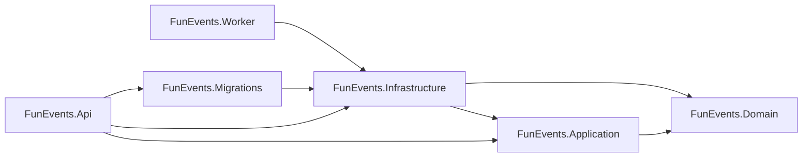

# ADR-001: Organize the backend using Clean Architecture

- **Status:** Accepted
- **Date:** 2026-11-08

## Context

The backend contains HTTP endpoints, reservation use cases, domain rules, PostgreSQL persistence, database migrations, and background processing. These concerns change for different reasons and should not be coupled directly to one another. In particular, business and application code should not depend on ASP.NET Core, EF Core, or PostgreSQL.

## Decision

Organize the backend as projects in one solution, with dependencies pointing inward toward the domain:

Responsibilities:

- **Domain** contains business concepts and rules. It has no dependency on the other backend projects or infrastructure frameworks.
- **Application** contains use cases and ports, such as reservation use cases, their input/result DTOs, and repository interfaces. It depends on Domain.
- **Infrastructure** implements application ports and contains PostgreSQL, EF Core, and persistence code. It depends on Application and Domain.
- **API** owns HTTP routes, request/response contracts, authentication at the HTTP boundary, and HTTP result mapping. It is a composition root that wires Application to Infrastructure. It references Migrations for development-time database initialization.
- **Worker** hosts background processes and wires them to Infrastructure and application ports.
- **Migrations** owns EF Core migration files and the design-time DbContext factory. It references Infrastructure, where the DbContext is defined.

### Use-case organization and API boundary

- Each application operation is represented by a use-case class in its own folder. The use-case class owns the operation flow, while its input and result DTOs live in that folder's `Dtos` subfolder.
- Use cases map domain entities to application result DTOs before returning to the API. API endpoints and HTTP mappers do not receive or serialize domain entities directly.
- The application uses explicit use-case inputs and results without introducing CQRS command/query abstractions, separate read models, or separate data stores.
- This separation is not currently strict: reservation lookup can transition an overdue reservation to `Expired` and release inventory. That behavior keeps a read response current, but should be revisited if queries are required to be side-effect-free.
- API routes are organized by feature. Each feature owns its HTTP contracts, request validation, endpoint mappings, and HTTP result mapping.
- An API endpoint binds HTTP input, obtains caller context, invokes an Application use case, and maps the outcome to an HTTP response. It does not call repositories or contain business rules directly.
- HTTP request and response DTOs are distinct from Application input and result DTOs. Application code does not reference ASP.NET Core types.
- Shared authentication and authorization concerns belong to the API security boundary, not to an individual business feature.

These project boundaries organize code and dependencies; they do not imply that each layer is a separately deployed service. API and Worker are separate executable hosts. They can share application and infrastructure code and use the same database.

## Consequences

- Domain and Application code can be reasoned about without depending on HTTP or database implementation details.
- API and Worker remain composition roots where infrastructure implementations are registered.
- HTTP contracts stay in the API; application inputs and results are separate from those contracts.
- Each API feature and Application use case has a clear place for its own contracts, validation, and outcome mapping. This adds files and folders, but keeps transport concerns and business workflows independently changeable.
- EF Core and PostgreSQL details remain in Infrastructure and Migrations.
- The solution has more projects, references, and dependency-injection wiring than a single-project application.
- API and Worker currently share persistence and database resources. This decision does not introduce separate databases, event sourcing, CQRS infrastructure, or a mediator library.
